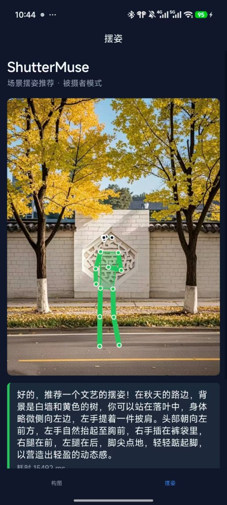

# ShutterMuse Mobile

基于 [ShutterMuse](https://github.com/lijayuTnT/ShutterMuse) 的 **Android 移动端扩展**：FastAPI 推理服务 + uni-app 客户端，支持 **构图** 与 **摆姿** 两个 Tab。

<p align="center">
  
</p>
<p align="center"><em>摆姿模式：绿色人形骨架 + AI 摆姿说明（真机截图）</em></p>

---

## 克隆后如何运行

### 1. 克隆仓库

```bash
git clone https://github.com/zyqqqqqqqqq/ShutterMuse-mobile.git
cd ShutterMuse-mobile
```

### 2. 启动推理服务（Server）

**推荐：本地或云 GPU + ShutterMuse 官方权重**

```bash
# 下载模型（约 18GB，首次需要）
pip install huggingface_hub
huggingface-cli download ShutterMuse/ShutterMuse --local-dir ./ShutterMuse-model

# 安装依赖并启动
cd server
pip install -r requirements-server.txt
pip install torch torchvision transformers peft accelerate qwen-vl-utils safetensors sentencepiece

export INFERENCE_BACKEND=local
export SHUTTERMUSE_MODEL_PATH=../ShutterMuse-model
export SUBJECT_MAX_NEW_TOKENS=2048
python -m uvicorn app.main:app --host 0.0.0.0 --port 8000
```

**无 GPU 备用方案（质量较低）：** 设置 `DASHSCOPE_API_KEY` 后使用 API 模式，见 [`server/README.md`](server/README.md)。

验证：

```bash
curl -s http://127.0.0.1:8000/health
curl -s -F "image=@test/401128801616615964.webp" http://127.0.0.1:8000/v1/pose
```

### 3. 配置并运行 Android 客户端

```bash
cd uni-app
cp config.example.js config.js   # Windows: copy config.example.js config.js
```

编辑 `config.js`，将 `BASE_URL` 改为 Server 地址（局域网 `http://IP:8000` 或云 GPU HTTPS 地址）。

用 **HBuilderX** 打开 `uni-app/` 目录 → **运行到 Android 真机** → 点击「测试服务器连接」→ 拍照分析。

---

## 文档

| 文档 | 说明 |
|------|------|
| [**docs/GETTING_STARTED.md**](docs/GETTING_STARTED.md) | **完整运行指南**（三种部署方案、环境变量、常见问题） |
| [docs/PROJECT_IMPLEMENTATION.md](docs/PROJECT_IMPLEMENTATION.md) | 项目实现历程与架构说明 |
| [server/README.md](server/README.md) | Server 环境变量与 API 说明 |
| [uni-app/README.md](uni-app/README.md) | HBuilderX 客户端配置 |
| [docs/GITHUB_PUBLISH_CHECKLIST.md](docs/GITHUB_PUBLISH_CHECKLIST.md) | 开源发布安全检查清单 |

---

## 相关链接

- 官方论文仓库：[lijayuTnT/ShutterMuse](https://github.com/lijayuTnT/ShutterMuse)
- 官网 Demo：[lijayutnt.github.io/ShutterMuse](https://lijayutnt.github.io/ShutterMuse/)
- 模型权重：[HuggingFace ShutterMuse/ShutterMuse](https://huggingface.co/ShutterMuse/ShutterMuse)
- 论文：[arXiv:2606.25763](https://arxiv.org/abs/2606.25763)

---

## 仓库结构

```text
├── server/       # FastAPI：/v1/composition、/v1/pose、/health
├── uni-app/      # HBuilderX Android 客户端
├── docs/         # 运行与设计文档
├── evaluation/   # 官方评测与 CLI 推理脚本
├── training/     # 官方训练脚本
└── test/         # 示例测试图片
```
