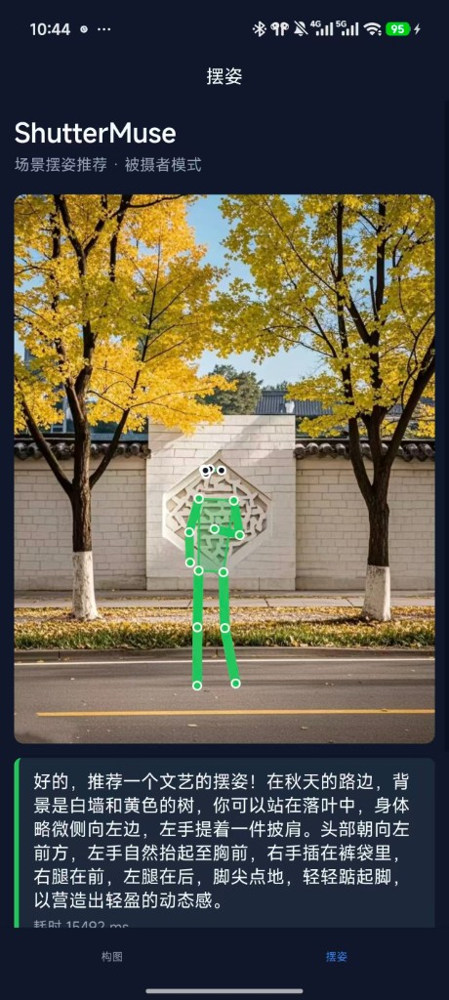

基于 [ShutterMuse](https://github.com/lijayuTnT/ShutterMuse) 的 **Android 移动端扩展**：FastAPI 推理服务 + uni-app 客户端，支持 **构图** 与 **摆姿** 两个 Tab。

<p align="center">
  
</p>

---

## 0. 你需要准备什么

| 组件 | 用途 | 是否必须 |
|------|------|----------|
| Python 3.10+ | 运行 `server/` | 是 |
| NVIDIA GPU + CUDA | 本地推理（推荐） | 摆姿/构图高质量时 **强烈建议** |
| [HuggingFace 模型权重](https://huggingface.co/ShutterMuse/ShutterMuse) | 本地推理 | GPU 模式必须（约 18GB） |
| [HBuilderX](https://www.dcloud.io/hbuilderx.html) | 编译/真机运行 uni-app | 跑手机 App 必须 |
| Android 手机 + USB 调试 | 真机测试 | 推荐 |
| 阿里云百炼 API Key | 无 GPU 时的备用方案 | 可选（质量低于官方权重） |

**架构简述：** 手机 App 只负责拍照和展示；推理在 Server 上完成（本机 GPU 或云 GPU）。

---

## 1. 克隆仓库

```bash
git clone https://github.com/zyqqqqqqqqq/ShutterMuse-mobile.git
cd ShutterMuse-mobile
```

---

## 2. 启动推理服务（三选一）

### 方案 A：本地 GPU + ShutterMuse 权重（推荐，质量最好）

**硬件要求：** NVIDIA GPU，显存建议 ≥ 16GB（RTX 4090 24GB 较稳妥；8GB 易 OOM）。

#### 2.A.1 下载模型

```bash
pip install huggingface_hub
huggingface-cli download ShutterMuse/ShutterMuse --local-dir ./ShutterMuse-model
```

#### 2.A.2 安装依赖

```bash
cd server
pip install -r requirements-server.txt
pip install torch torchvision transformers peft accelerate qwen-vl-utils safetensors sentencepiece
```

> 完整训练/评测依赖见仓库根目录 `requirements.txt`；Server 只需上述包。

#### 2.A.3 启动

**Windows PowerShell：**

```powershell
cd server
$env:INFERENCE_BACKEND="local"
$env:SHUTTERMUSE_MODEL_PATH="D:\path\to\ShutterMuse-model"   # 改为您的模型目录
$env:SUBJECT_MAX_NEW_TOKENS="2048"                            # 摆姿 token 上限，4090 推荐 2048
py -m uvicorn app.main:app --host 0.0.0.0 --port 8000
```

**Linux / macOS：**

```bash
cd server
export INFERENCE_BACKEND=local
export SHUTTERMUSE_MODEL_PATH=/path/to/ShutterMuse-model
export SUBJECT_MAX_NEW_TOKENS=2048
python -m uvicorn app.main:app --host 0.0.0.0 --port 8000
```

首次启动会加载模型，约 **1–3 分钟**。终端出现 `Uvicorn running on http://0.0.0.0:8000` 即表示服务已监听。

#### 2.A.4 验证

```bash
curl -s http://127.0.0.1:8000/health
# 期望: "model_loaded": true, "backend": "local-qwen"

curl -s -F "image=@../test/401128801616615964.webp" http://127.0.0.1:8000/v1/composition
curl -s -F "image=@../test/401128801616615964.webp" http://127.0.0.1:8000/v1/pose
```

---

### 方案 B：云 GPU（AutoDL 等）

适合本机无足够显存、但希望使用 **真实 ShutterMuse 权重** 的场景。

#### 2.B.1 租用 GPU 实例

- 推荐：RTX 4090 24GB
- 将本仓库 clone 到实例（如 `/root/autodl-tmp/ShutterMuse-mobile`）

#### 2.B.2 一键脚本（可参考）

```bash
cd server
chmod +x deploy-autodl.sh
# 按需修改脚本内 REPO_DIR / MODEL_DIR / PORT
./deploy-autodl.sh
```

或手动执行（与方案 A 相同，路径改为 Linux）：

```bash
pip install -r server/requirements-server.txt
pip install torch torchvision transformers peft accelerate qwen-vl-utils safetensors sentencepiece huggingface_hub

huggingface-cli download ShutterMuse/ShutterMuse --local-dir /root/autodl-tmp/ShutterMuse-model

cd server
export INFERENCE_BACKEND=local
export SHUTTERMUSE_MODEL_PATH=/root/autodl-tmp/ShutterMuse-model
export SUBJECT_MAX_NEW_TOKENS=2048
python -m uvicorn app.main:app --host 0.0.0.0 --port 6006
```

#### 2.B.3 公网访问

在 AutoDL 控制台配置 **自定义服务**：内网端口 `6006` → 映射为 HTTPS 公网地址（如 `https://xxx.region.seetacloud.com:8443`）。

客户端 `BASE_URL` 填该 HTTPS 地址。

---

### 方案 C：无 GPU，使用 DashScope API（快速体验，摆姿质量有限）

> **注意：** 此为通用 Qwen-VL API，**不是** ShutterMuse 微调权重，摆姿效果与官网 Demo 差距较大。仅适合快速验证构图流程。

1. 在 [阿里云百炼](https://dashscope.console.aliyun.com) 申请 API Key  
2. 启动：

```powershell
cd server
$env:DASHSCOPE_API_KEY="您的API_Key"
$env:INFERENCE_BACKEND="api"
.\start-api.ps1
```

或：

```powershell
$env:DASHSCOPE_API_KEY="您的API_Key"
$env:INFERENCE_BACKEND="api"
py -m uvicorn app.main:app --host 0.0.0.0 --port 8000
```

验证 `/health` 应返回 `"backend": "qwen-vl-api"`。

---

## 3. 配置并运行 Android 客户端

### 3.1 创建本地配置

仓库 **不包含** `uni-app/config.js`（已在 `.gitignore`），需从模板复制：

```bash
cd uni-app
cp config.example.js config.js    # Windows: copy config.example.js config.js
```

编辑 `config.js`：

```js
export const BASE_URL = 'http://192.168.1.100:8000'  // 改为您 Server 的地址
```

| 场景 | BASE_URL 示例 |
|------|----------------|
| 手机与电脑同一 Wi-Fi | `http://<电脑局域网IP>:8000` |
| 云 GPU（AutoDL HTTPS） | `https://<您的公网域名>:8443` |
| 本机模拟器调试 | `http://10.0.2.2:8000`（Android 模拟器访问宿主机） |

### 3.2 HBuilderX 运行

1. 安装 [HBuilderX](https://www.dcloud.io/hbuilderx.html)  
2. **文件 → 打开目录** → 选择仓库中的 `uni-app/` 文件夹  
3. 手机开启 **USB 调试**，USB 连接电脑  
4. **运行 → 运行到手机或模拟器 → 运行到 Android App 基座**  
5. App 内切换底部 Tab：**构图** / **摆姿** → 拍照或选图 → 点击分析  

### 3.3 App 内自检

点击 **「测试服务器连接」**：

- 成功：提示「推理服务就绪」  
- 失败：检查 `BASE_URL`、防火墙、Server 是否运行、云实例是否开机  

---

## 4. 端到端验收清单

- [ ] `curl http://<server>/health` → `model_loaded: true`  
- [ ] `curl -F "image=@test/401128801616615964.webp" .../v1/composition` 有 `decision`  
- [ ] `curl -F "image=@test/401128801616615964.webp" .../v1/pose` → `parse_ok: true`，17 个关键点  
- [ ] App「测试服务器连接」成功  
- [ ] 构图页：分析后显示红框（refine 时）  
- [ ] 摆姿页：分析后显示绿色人形骨架（约 15–60 秒，云端更慢）  

---

## 5. 环境变量速查

| 变量 | 方案 A/B | 方案 C |
|------|----------|--------|
| `INFERENCE_BACKEND` | `local` | `api` |
| `SHUTTERMUSE_MODEL_PATH` | 模型目录 | — |
| `SHUTTERMUSE_LORA_PATH` | 可选 LoRA 路径 | — |
| `SUBJECT_MAX_NEW_TOKENS` | 推荐 `2048`（官方 CLI 默认 10240，大显存可试） | — |
| `DASHSCOPE_API_KEY` | — | 必填 |
| `VISION_API_MODEL` | — | 默认 `qwen-vl-plus` |
| `MAX_UPLOAD_BYTES` | 可选，默认 5MB | 同左 |

---

## 6. 常见问题

| 现象 | 原因 | 处理 |
|------|------|------|
| `/health` 中 `model_loaded: false` | Server 未正确启动或仍在加载 | 等待 1–3 分钟；查看终端日志 |
| 503 MODEL_BUSY | 同时多个请求 | 等上一个推理完成（单 GPU 单锁） |
| 摆姿 `parse_ok: false` | API 模式或旧版 inference | 改用 local + ShutterMuse 权重 |
| CUDA OOM | `SUBJECT_MAX_NEW_TOKENS` 过大 | 设为 `2048`；确保只有一个 uvicorn 进程 |
| 手机连接失败（局域网） | IP 错误或不同网络 | 同一 Wi-Fi；关 4G/5G；查电脑 IP |
| 手机连接失败（云端） | 实例关机或 URL 错误 | 确认 AutoDL 运行中；HTTPS 端口正确 |
| DeepSeek API 报错 | 不支持图片 | 改用 DashScope 或本地 GPU |
| 找不到 `config.js` | 未从 example 复制 | `cp config.example.js config.js` |

---

## 7. 目录与文档索引

```text
ShutterMuse-mobile/
├── server/                          # FastAPI 推理服务
│   ├── README.md                    # Server 环境变量说明
│   ├── start-api.ps1                # API 模式一键启动（Windows）
│   └── deploy-autodl.sh             # 云 GPU 部署参考脚本
├── uni-app/                         # HBuilderX 客户端
│   ├── config.example.js            # 配置模板 → 复制为 config.js
│   └── README.md
├── test/                            # 示例图片（curl 测试用）
├── docs/
│   ├── GETTING_STARTED.md           # ★ 克隆后运行指南（从这里开始）
│   ├── PROJECT_IMPLEMENTATION.md    # 完整实现历程
│   └── GITHUB_PUBLISH_CHECKLIST.md  # 发布安全检查
└── evaluation/                      # 官方 CLI 推理与评测脚本
```

**延伸阅读：**

- 实现背景与踩坑记录：[`PROJECT_IMPLEMENTATION.md`](./PROJECT_IMPLEMENTATION.md)  
- 发布前安全检查：[`GITHUB_PUBLISH_CHECKLIST.md`](./GITHUB_PUBLISH_CHECKLIST.md)  
- 官方论文仓库：https://github.com/lijayuTnT/ShutterMuse  

---

## 8. 最快路径（有 4090 云 GPU）

```bash
# 1. 克隆
git clone https://github.com/zyqqqqqqqqq/ShutterMuse-mobile.git && cd ShutterMuse-mobile

# 2. 云上下载模型 + 启动 Server（见方案 B）
# 3. 本地复制 uni-app 配置，填入云 HTTPS 地址
cd uni-app && cp config.example.js config.js
# 编辑 config.js → BASE_URL = 'https://您的公网地址:8443'

# 4. HBuilderX 打开 uni-app/，真机运行，测试连接 → 分析摆姿
```

---

*文档版本：2026-07-07 · 适用于 ShutterMuse-mobile 私有仓库初始版本*
