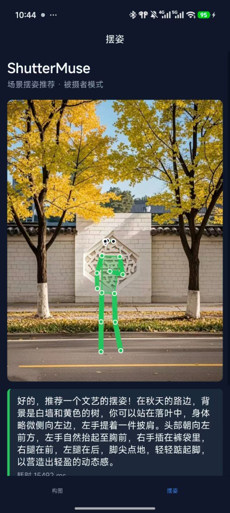

# ShutterMuse uni-app 客户端

<p align="center">
  
</p>
<p align="center"><em>摆姿模式：绿色人形骨架 + AI 摆姿说明（真机截图）</em></p>

HBuilderX 打开的 uni-app 工程，调用 `server/` 提供的构图与摆姿 API。

> **首次使用请先阅读：** [`docs/GETTING_STARTED.md`](../docs/GETTING_STARTED.md)（克隆后完整运行步骤）

## 1. 配置服务器地址

```bash
cp config.example.js config.js
```

编辑 `config.js`：

```js
export const BASE_URL = 'http://192.168.1.100:8000'  // 改为您的 Server 地址
```

云端 GPU 部署时使用 HTTPS 公网地址，例如 `https://您的域名:端口`。

## 2. 启动后端

见 `server/README.md`。无 GPU 时可用 Qwen-VL API（阿里云百炼）：

```powershell
cd server
$env:DASHSCOPE_API_KEY="您的API_Key"
$env:INFERENCE_BACKEND="api"
py -m uvicorn app.main:app --host 0.0.0.0 --port 8000
```

> DeepSeek 官方 API 不支持图片。API Key 在 [dashscope.console.aliyun.com](https://dashscope.console.aliyun.com) 申请。

有 GPU 时推荐本地 ShutterMuse 权重（见 `server/README.md` 与 `docs/PROJECT_IMPLEMENTATION.md`）。

## 3. HBuilderX 运行

1. 打开 HBuilderX
2. **文件 → 打开目录** → 选择本仓库下的 `uni-app/` 文件夹
3. 手机 USB 连接并开启 USB 调试，或使用同一 Wi-Fi
4. **运行 → 运行到手机或模拟器 → 运行到 Android App 基座**
5. 底部 Tab：**构图** 或 **摆姿** → 拍照 → 分析

## 4. 云打包 APK（可选）

HBuilderX → **发行 → 原生 App-云打包**，按向导生成 APK。

## 5. 常见问题

| 问题 | 处理 |
|------|------|
| 连接失败 | 检查 `config.js` 中的 `BASE_URL`、防火墙、网络 |
| 503 模型未加载 | 确认 Server 已启动且模型路径正确 |
| 相机打不开 | 在手机设置中授予 App 相机权限 |
| HTTP 被拦截 | `manifest.json` 已设 `usesCleartextTraffic: true`（局域网调试） |

## 6. 目录结构

```text
uni-app/
├── config.example.js   # 配置模板（提交到 Git）
├── config.js           # 本地配置（不提交，见 .gitignore）
├── pages/index/        # 构图页
├── pages/pose/         # 摆姿页
├── utils/api.js        # HTTP 封装
├── utils/pose.js       # 人形骨架绘制
└── utils/bbox.js       # 构图框样式
```
